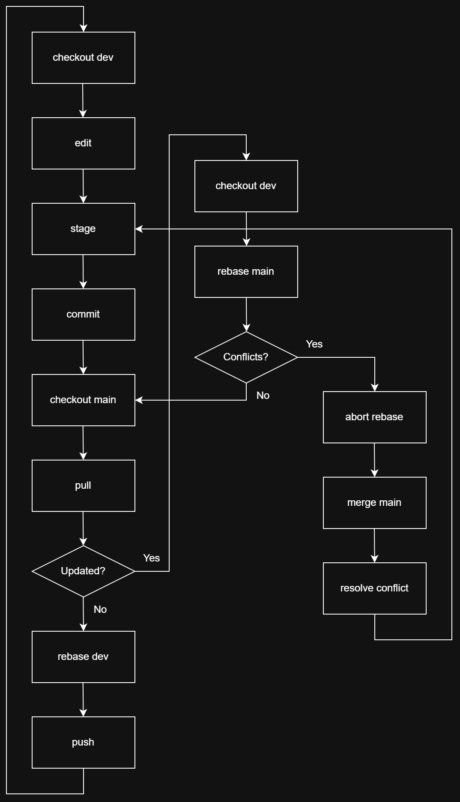

# Work Flow

---

## Flowchart

Commit, pull and push workflow using a tracking (main) and local (dev) branch.

Drawn with [Draw.io](https://www.drawio.com/).



> [!NOTE]
> Not necessarily have to pull again right after confirming that there was no
> conflict with the `dev` branch. If there was no conflict, just push it right away.

---

## Common Commands

### Update Local with Remote

```sh
git switch main

git pull --rebase

git switch dev

git rebase main
```

> [!TIP]
> Prefer `switch` instead of `checkout` now a days.

### Commit and Push

```sh
git stage -A

git commit -m "hi mom"

git switch main

git pull --rebase

git rebase dev

git push
```

### Abort Rebase

When there is conflict abort rebase:

```sh
git rebase --abort
```

After resolving conflict from `dev` branch, **merge** it into `main` instead of
rebase to create new commit after resolving conflict.

```sh
git switch main

git merge dev
```
